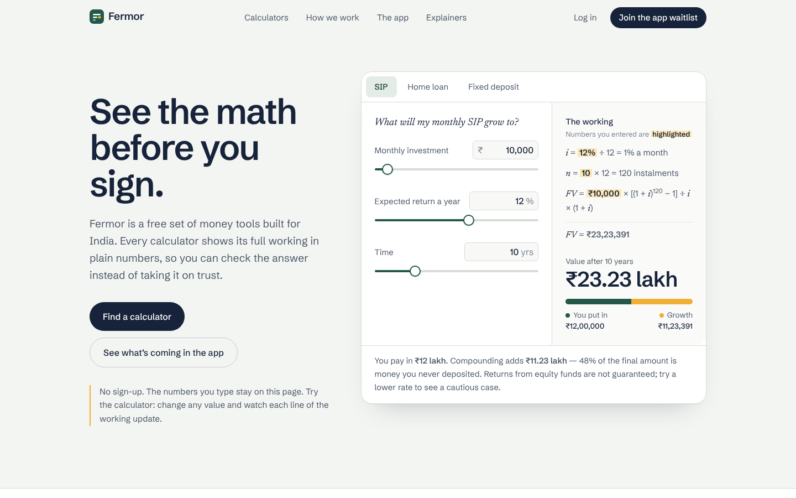
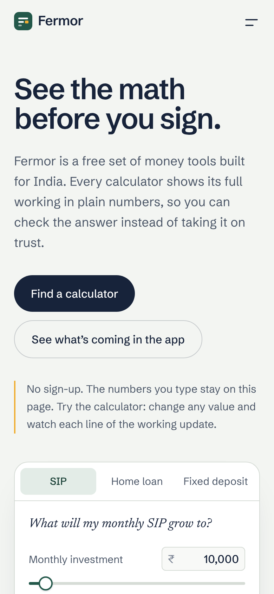

# Fermor — homepage

A new homepage for [Fermor](https://fermor.in), built for the Frontend Developer assignment.

**Live:** [fermor-home-eight.vercel.app](https://fermor-home-eight.vercel.app/) · **Stack:** Next.js 15 (App Router), React 19, TypeScript, Tailwind CSS v4

| Desktop | Mobile |
| --- | --- |
|  |  |

## Run it

```bash
npm install
npm run dev      # http://localhost:3000
npm run build    # static export to ./out
```

Node 18.18+ is required. The site is a static export (`output: "export"`), so it deploys to Vercel with zero config, or to any static host by uploading `out/`.

## The idea in one line

**See the math before you sign.** Fermor's real advantage over bank calculators and comparison sites is that it shows the full working and doesn't try to sell you a loan. So the homepage doesn't *describe* that — it *demonstrates* it in the first screen.

## Key decisions

### Product

- **Who it's for.** Salaried Indians aged roughly 22–40 making their first big money decisions: a first SIP, a home loan, a tax-regime choice. Mostly on phones, wary of being sold to.
- **Lead with the product, not a promise.** The hero is a working SIP / home loan / FD calculator. It answers a real question before the visitor scrolls, which is the strongest proof that the tools are free and need no sign-up.
- **Show the working.** Under every result, the formula is written out line by line with the visitor's own numbers highlighted (marigold, like a highlighter pen on a notebook). Change a slider and every line updates. This is the page's one memorable idea; everything else is kept quiet around it.
- **Translate the answer into plain words.** Each result ends with a one-sentence reading — e.g. "₹54 lakh of what you repay is interest, 1.08× what you borrowed" — and an honest caveat (returns aren't guaranteed, FD interest is taxed at your slab).
- **Index by decision, not by formula.** People arrive with "can I afford this flat?", not "I need a reducing-balance amortisation tool". The calculator list is written as questions, grouped by Borrowing / Saving and investing / Tax and salary / Planning ahead.
- **Trust is a section, stated as checkable promises.** Data stays on the device, no login wall, ads are labelled, method is on the page — plus the SEBI disclaimer said plainly rather than hidden in the footer.
- **The app is positioned as the next step, not the headline.** The live site leads with an app waitlist that doesn't exist yet. I reversed that: calculators first (what works today), then the app as "the same clear math, run on your own money", with an Ask preview whose answer also offers "Show the working" so the two halves feel like one product.
- **Explainers prove Fermor keeps up.** Three recent explainers link to the real blog, framed as "when the rules change, we work out what it means for you".

### Design

- **Palette.** Cool paper (`#f3f5f2`), indigo ink (`#17233a`), passbook ledger green (`#23584a`) and marigold (`#f0ae32`). Marigold is reserved for one job — marking the visitor's numbers — so it always means the same thing. The single dark band (ledger green) is used for the trust section to give it weight.
- **Type.** Schibsted Grotesk for everything (sturdy, slightly editorial, excellent figures); Newsreader italic only where it means something: maths variables, the calculator's question, the disclaimer, explainer headlines. Tabular figures everywhere numbers sit in columns.
- **Indian number formatting.** `₹23,23,391` and "₹23.23 lakh", never "$2.3M". Lakh/crore are how the audience thinks.
- **Restraint.** No stock illustrations, no gradients, no fade-in on every section. One motion moment: the working lines write in when you switch calculator. `prefers-reduced-motion` turns it off.
- **Layout.** A consistent 0.82 / 1.18 split carries through hero, decisions and FAQ, so the page reads as one system. Lists use rules rather than cards, so a page with a lot of content still feels calm.

### Engineering

- **Math is isolated and tested.** `src/lib/finance.ts` holds pure functions (SIP, EMI, FD) using the same conventions Indian banks and AMCs publish. Verified against reference values: SIP ₹10,000/12%/10y → ₹23,23,391; EMI ₹50L/8.5%/20y → ₹43,391; FD ₹1L/7%/5y quarterly → ₹1,41,478.
- **Inputs are both sliders and typed values**, clamped to sensible ranges, so it works with thumbs and keyboards.
- **Static and light.** No backend, no tracking, ~108 kB first-load JS. Fonts are self-hosted via Fontsource (no third-party font requests, matching the privacy promise).
- **Accessibility.** Semantic landmarks, skip link, labelled inputs, ARIA tabs for the calculator, `aria-live` result, visible focus rings, native `<details>` for the FAQ, AA contrast on all text.
- **Waitlist** validates the email and confirms in place. There's no backend in scope, so nothing is sent; wiring it to an API route or form service is a one-function change in `Waitlist.tsx`.

## What I'd do next

- A shareable URL for any calculation (`?amt=10000&rate=12&yrs=10`) so people can send a result to family.
- A year-by-year table under "the working" (amortisation for loans, growth for SIP).
- Hindi and Gujarati versions — the blog is already multilingual.
- Real waitlist endpoint and analytics on which decision rows get clicked, to reorder them.

## Project structure

```
src/
  app/            layout, page, global tokens (globals.css), icon
  components/     SiteHeader, WorkingCalculator, AskPreview, Waitlist, Logo
  lib/finance.ts  SIP, EMI and FD math + Indian number formatting
```
